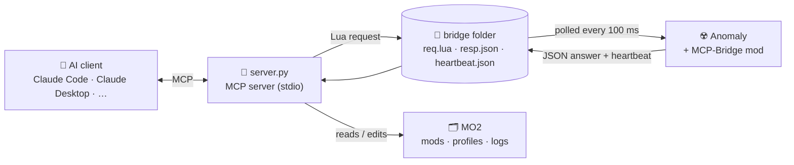

<div align="center">

# ☢️ stalker-mcp

**Let an AI assistant see, query and drive a live game of S.T.A.L.K.E.R. Anomaly.**

An [MCP](https://modelcontextprotocol.io) server that connects Claude (or any MCP client)
to *S.T.A.L.K.E.R. Anomaly* running under *Mod Organizer 2*: run Lua inside the game,
spawn items, read logs and crashes, take screenshots, resolve mod conflicts.


**English** · [Русский](README.ru.md)

</div>

---

## What is this?

Modding Anomaly usually means: edit a script → restart the game → wait two minutes →
read a 50 000-line log. **stalker-mcp** gives an AI assistant direct access to the running game,
so you can just ask:

> *"Why did the game crash?"* · *"Which mod overrides `xr_effects.script`?"* ·
> *"Spawn 5 medkits and a Vintorez."* · *"Set midnight and a storm, then take a screenshot."* ·
> *"How many stalkers are alive on this level, grouped by faction?"*

The assistant answers by calling tools: it runs Lua in the game's own environment
(`db.actor`, `alife()`, `level`, `ini_sys`, every `xr_*` module), reads the engine log,
walks your MO2 load order and looks at the screen.

## How it works



* The game side is a tiny Lua mod, **MCP-Bridge** (`mcp_bridge.script`). Every 100 ms it checks
  `req.lua`, runs the code with `xpcall` and writes the result to `resp.json`. Once a second
  it writes `heartbeat.json`, so the server knows the game is alive.
* No DLLs, no engine patches, no network ports: plain files only.
* Tools that don't need the game (logs, mods, file search) work even when it is closed.

## Tools

| Tool | What it does | Needs game |
|---|---|:---:|
| `game_status` | Game / MO2 processes, bridge heartbeat, current level, crash flag | – |
| `game_lua` | Run Lua inside the game (REPL-like: an expression returns its value) | ✅ |
| `game_console` | Run an engine console command (`time_factor 10`, `g_god 1`, …) | ✅ |
| `game_player` | Level, position, health, money, rank, faction, time, weather, inventory | ✅ |
| `game_spawn` | Spawn a section into the inventory or into the world in front of the player | ✅ |
| `game_screenshot` | Engine screenshot, returned to the assistant as an image | ✅ |
| `game_log` | Tail of `xray_<user>.log`, optional regex filter | – |
| `game_crash` | The last `FATAL ERROR` block with the Lua stack | – |
| `game_saves` | Saves, newest first | – |
| `game_launch` | Start the game through MO2, optionally loading a save directly | – |
| `mo2_mods` | Mod list of the active profile, in priority order | – |
| `mo2_set_mod` | Enable / disable / move a mod (MO2 must be closed) | – |
| `files_resolve` | Which mod supplies a given `gamedata` file, and who it overrides | – |
| `files_grep` | Regex search across the files the game actually sees, respecting mod priority | – |

`game_lua` returns game objects as `{id, name, section}` and vectors as `{x, y, z}`.
Globals you define persist between calls, and `print()` output is collected.

## Requirements

* Windows 10/11
* S.T.A.L.K.E.R. Anomaly 1.5.x (also works with modpacks built on it, e.g. GAMMA)
* A **portable** Mod Organizer 2 instance
* Python 3.10+
* An MCP client: [Claude Code](https://claude.com/claude-code), Claude Desktop or any other

## Installation

**1. Get the server**

```powershell
git clone https://github.com/DrakuXYZ/stalker-mcp.git
cd stalker-mcp
python -m venv .venv
.venv\Scripts\pip install -r requirements.txt
```

**2. Install the game mod**

Close MO2 and the game, then run:

```powershell
$env:STALKER_GAME = "D:\Games\Anomaly"       # folder with bin\ and gamedata\
$env:STALKER_MO2  = "D:\Games\Anomaly\MO2"   # folder with ModOrganizer.exe
.venv\Scripts\python server.py install
```

This writes `mods\MCP-Bridge` with the bridge path filled in and enables it in the active profile.

**3. Connect your MCP client**

Claude Code:

```powershell
claude mcp add stalker -s user `
  -e STALKER_GAME=D:\Games\Anomaly `
  -e STALKER_MO2=D:\Games\Anomaly\MO2 `
  -- D:\stalker-mcp\.venv\Scripts\python.exe D:\stalker-mcp\server.py
```

Claude Desktop (`claude_desktop_config.json`) and most other clients:

```json
{
  "mcpServers": {
    "stalker": {
      "command": "D:\\stalker-mcp\\.venv\\Scripts\\python.exe",
      "args": ["D:\\stalker-mcp\\server.py"],
      "env": {
        "STALKER_GAME": "D:\\Games\\Anomaly",
        "STALKER_MO2": "D:\\Games\\Anomaly\\MO2"
      }
    }
  }
}
```

**4. Play.** Start the game from MO2 (or ask the assistant to run `game_launch`), load a save,
and ask away. Check the connection with `game_status`: the bridge should be `онлайн` (online).

## Configuration

| Variable | Required | Default | Meaning |
|---|:---:|---|---|
| `STALKER_GAME` | ✅ | – | Game folder (`bin\`, `gamedata\`, `appdata\`) |
| `STALKER_MO2` | ✅ | – | Portable MO2 folder (`ModOrganizer.exe`, `mods\`, `profiles\`) |
| `STALKER_BRIDGE` | | `%LOCALAPPDATA%\stalker-mcp\bridge` | Exchange folder. **Must be outside the game and MO2 folders.** Re-run `install` after changing it |
| `STALKER_SCREENSHOTS` | | `%LOCALAPPDATA%\stalker-mcp\screenshots` | Where screenshots are moved |
| `STALKER_UNPACKED` | | – | Unpacked vanilla `.db` archives: adds the base game to `files_resolve` / `files_grep` |
| `STALKER_EXE` | | `Anomaly (DX11-AVX)` | MO2 executable name used by `game_launch` |

## Good to know

* **The bridge starts with the first loaded save.** In the main menu before that, game tools
  report that the game is not responding. After the first load it also works in the ESC menu
  and on the death screen.
* **The game pauses when it loses focus.** Nothing is polled while it is paused. Run the game
  windowed or borderless with `g_always_active on` in the console.
  A custom engine can call `_G.on_paused_tick()` while paused to keep the bridge alive.
* **The bridge folder must be outside the game folder.** MO2's virtual file system redirects
  new files created inside it to `overwrite`, and the server would never see them.
  For the same reason `req.lua` and `resp.json` are created before the game starts and are
  only overwritten, never deleted.
* **Updated the bridge script?** Restart the game. The server checks the bridge version in the
  heartbeat and refuses to talk to an outdated one.
* **`mo2_set_mod` needs MO2 closed.** MO2 rewrites `modlist.txt` on exit.
* Strings come from the engine in cp1251. The server decodes them, and Cyrillic in requests
  is sent as cp1251, so it matches the game's own strings.
* Tool descriptions and messages are in Russian. The models handle that fine.

## ⚠️ Security

`game_lua` runs **arbitrary code** inside the game. Anomaly's Lua has the `io` and `os` libraries,
so that code can do anything your Windows user can do.

* Anyone who can write to the bridge folder can run code in your game. The default folder is in
  your user profile.
* Use it with assistants and prompts you trust.
* Disable the MCP-Bridge mod in MO2 when you don't need it.

## Troubleshooting

| Symptom | Fix |
|---|---|
| `game_status` → `нет пульса` (no heartbeat) | The mod is not enabled, or the bridge paths differ: re-run `server.py install` |
| `молчит` (silent) | The game is loading, paused (no focus) or still in the main menu before the first save |
| `Игра забрала запрос, но не ответила` (took the request, no answer) | The game probably crashed: run `game_crash` |
| `мост версии X, сервер ждёт Y` (version mismatch) | Restart the game after updating the bridge |
| The server does not start | `STALKER_GAME` / `STALKER_MO2` are not set or point to missing folders |

## License

[MIT](LICENSE). S.T.A.L.K.E.R. is a trademark of GSC Game World. This is an unofficial fan tool.
