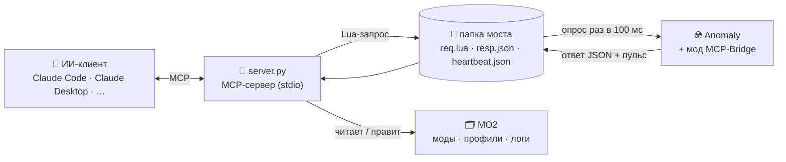

<div align="center">

# ☢️ stalker-mcp

**ИИ-ассистент видит живую игру S.T.A.L.K.E.R. Anomaly, задаёт ей вопросы и управляет ею.**

[MCP](https://modelcontextprotocol.io)-сервер, который подключает Claude (или любой MCP-клиент)
к *S.T.A.L.K.E.R. Anomaly* под *Mod Organizer 2*. Он исполняет Lua прямо в игре, спавнит
предметы, читает логи и вылеты, делает скриншоты и разбирает конфликты модов.


<a href="README.md"></a>
<a href="README.ru.md"></a>

</div>

---

## Что это такое

Обычно моддинг Anomaly выглядит так: поправил скрипт → перезапустил игру → подождал две минуты →
читаешь лог на 50 000 строк. **stalker-mcp** даёт ИИ-ассистенту прямой доступ к запущенной игре,
поэтому можно просто спросить:

> *«Почему вылетела игра?»* · *«Какой мод перекрывает `xr_effects.script`?»* ·
> *«Дай 5 аптечек и Винторез».* · *«Поставь полночь и грозу, потом сделай скриншот».* ·
> *«Сколько живых сталкеров на уровне, по группировкам?»*

Ассистент отвечает, вызывая инструменты. Он исполняет Lua в окружении самой игры
(`db.actor`, `alife()`, `level`, `ini_sys`, все модули `xr_*`), читает лог движка,
проходит по порядку модов MO2 и смотрит на экран.

## Как это работает



* Игровая часть — маленький Lua-мод **MCP-Bridge** (`mcp_bridge.script`). Каждые 100 мс он
  проверяет `req.lua`, исполняет код через `xpcall` и пишет результат в `resp.json`.
  Раз в секунду он пишет `heartbeat.json`, и по этому пульсу сервер знает, что игра жива.
* Никаких DLL, патчей движка и сетевых портов: только обычные файлы.
* Инструменты, которым игра не нужна (логи, моды, поиск по файлам), работают и при закрытой игре.

## Инструменты

| Инструмент | Что делает | Нужна игра |
|---|---|:---:|
| `game_status` | Процессы игры и MO2, пульс моста, текущий уровень, был ли вылет | – |
| `game_lua` | Исполнить Lua в игре (как REPL: выражение возвращает своё значение) | ✅ |
| `game_console` | Консольная команда движка (`time_factor 10`, `g_god 1`, …) | ✅ |
| `game_player` | Уровень, позиция, здоровье, деньги, ранг, группировка, время, погода, инвентарь | ✅ |
| `game_spawn` | Заспавнить секцию в рюкзак или в мир перед игроком | ✅ |
| `game_screenshot` | Скриншот движком, ассистент получает его картинкой | ✅ |
| `game_log` | Хвост `xray_<user>.log`, фильтр по регулярке | – |
| `game_crash` | Последний блок `FATAL ERROR` со стеком Lua | – |
| `game_saves` | Сейвы, свежие первыми | – |
| `game_launch` | Запустить игру через MO2, можно сразу с загрузкой сейва | – |
| `mo2_mods` | Список модов активного профиля по приоритету | – |
| `mo2_set_mod` | Включить, выключить или передвинуть мод (MO2 должен быть закрыт) | – |
| `files_resolve` | Какой мод поставляет файл `gamedata` и кого он перекрывает | – |
| `files_grep` | Регулярка по файлам, которые видит игра, с учётом приоритета модов | – |

`game_lua` отдаёт игровые объекты как `{id, name, section}`, векторы — как `{x, y, z}`.
Заданные глобалы живут между вызовами, вывод `print()` собирается в ответ.

## Что нужно

* Windows 10/11
* S.T.A.L.K.E.R. Anomaly 1.5.x (и сборки на нём, например GAMMA)
* **Портативный** Mod Organizer 2
* Python 3.10+
* MCP-клиент, который умеет запускать **локальные (stdio)** серверы: Claude Code, Claude Desktop,
  Codex CLI, Gemini CLI, Kimi CLI, Cursor, VS Code, Cline, LM Studio… (см. [Совместимость](#совместимость))

## Установка

**1. Сервер**

```powershell
git clone https://github.com/DrakuXYZ/stalker-mcp.git
cd stalker-mcp
python -m venv .venv
.venv\Scripts\pip install -r requirements.txt
```

**2. Мод для игры**

Закрой MO2 и игру, затем выполни:

```powershell
$env:STALKER_GAME = "D:\Games\Anomaly"       # папка с bin\ и gamedata\
$env:STALKER_MO2  = "D:\Games\Anomaly\MO2"   # папка с ModOrganizer.exe
.venv\Scripts\python server.py install
```

Команда создаст `mods\MCP-Bridge` с прописанным путём к папке моста и включит мод в активном профиле.

**3. Подключение к MCP-клиенту**

Любому клиенту нужны три вещи: команда (`.venv\Scripts\python.exe`), аргумент (`server.py`)
и две переменные окружения. Выбери свой:

<details open>
<summary><b>Claude Code</b></summary>

Выполни в `cmd` или Git Bash (Windows PowerShell 5.1 съедает `--`):

```bat
claude mcp add stalker -s user -e STALKER_GAME=D:\Games\Anomaly -e STALKER_MO2=D:\Games\Anomaly\MO2 -- D:\stalker-mcp\.venv\Scripts\python.exe D:\stalker-mcp\server.py
```

</details>

<details>
<summary><b>Claude Desktop · Cursor · Gemini CLI · Kimi CLI · Cline · LM Studio</b></summary>

У всех один и тот же JSON `mcpServers`. Положи его в файл настроек MCP клиента:

| Клиент | Файл настроек |
|---|---|
| Claude Desktop | `%APPDATA%\Claude\claude_desktop_config.json` |
| Cursor | `%USERPROFILE%\.cursor\mcp.json` (или `.cursor\mcp.json` в проекте) |
| Gemini CLI | `%USERPROFILE%\.gemini\settings.json` |
| Kimi CLI, Cline, LM Studio | файл настроек MCP клиента (тот же формат) |

```json
{
  "mcpServers": {
    "stalker": {
      "command": "D:\\stalker-mcp\\.venv\\Scripts\\python.exe",
      "args": ["D:\\stalker-mcp\\server.py"],
      "env": {
        "STALKER_GAME": "D:\\Games\\Anomaly",
        "STALKER_MO2": "D:\\Games\\Anomaly\\MO2"
      }
    }
  }
}
```

</details>

<details>
<summary><b>OpenAI Codex CLI</b></summary>

`%USERPROFILE%\.codex\config.toml`:

```toml
[mcp_servers.stalker]
command = 'D:\stalker-mcp\.venv\Scripts\python.exe'
args = ['D:\stalker-mcp\server.py']

[mcp_servers.stalker.env]
STALKER_GAME = 'D:\Games\Anomaly'
STALKER_MO2 = 'D:\Games\Anomaly\MO2'
```

</details>

<details>
<summary><b>VS Code (GitHub Copilot)</b></summary>

`.vscode\mcp.json` в рабочей папке (ключ `servers`, а не `mcpServers`):

```json
{
  "servers": {
    "stalker": {
      "type": "stdio",
      "command": "D:\\stalker-mcp\\.venv\\Scripts\\python.exe",
      "args": ["D:\\stalker-mcp\\server.py"],
      "env": {
        "STALKER_GAME": "D:\\Games\\Anomaly",
        "STALKER_MO2": "D:\\Games\\Anomaly\\MO2"
      }
    }
  }
}
```

</details>

**4. Играй.** Запусти игру из MO2 (или попроси ассистента вызвать `game_launch`), загрузи сейв
и спрашивай. Связь проверяется через `game_status`: мост должен быть `онлайн`.

## Настройки

| Переменная | Обязательна | По умолчанию | Что это |
|---|:---:|---|---|
| `STALKER_GAME` | ✅ | – | Папка игры (`bin\`, `gamedata\`, `appdata\`) |
| `STALKER_MO2` | ✅ | – | Папка портативного MO2 (`ModOrganizer.exe`, `mods\`, `profiles\`) |
| `STALKER_BRIDGE` | | `%LOCALAPPDATA%\stalker-mcp\bridge` | Папка обмена. **Обязательно вне папок игры и MO2.** После смены пути повтори `install` |
| `STALKER_SCREENSHOTS` | | `%LOCALAPPDATA%\stalker-mcp\screenshots` | Куда переносить скриншоты |
| `STALKER_UNPACKED` | | – | Распакованные `.db` ванильной игры: добавляет базовую игру в `files_resolve` / `files_grep` |
| `STALKER_EXE` | | `Anomaly (DX11-AVX)` | Имя исполняемого файла в MO2 для `game_launch` |

## Полезно знать

* **Мост оживает с первой загрузкой сейва.** До неё, в главном меню, игровые инструменты отвечают,
  что игра не отвечает. После первой загрузки мост работает и в меню ESC, и на экране смерти.
* **Без фокуса игра встаёт на паузу**, и на паузе мост молчит. Запускай игру в окне или в
  безрамочном режиме и введи в консоли `g_always_active on`.
  Свой движок может вызывать `_G.on_paused_tick()` на паузе, тогда мост работает и там.
* **Папка моста — только вне папки игры.** Виртуальная файловая система MO2 уводит новые файлы
  оттуда в `overwrite`, и сервер их не увидит. По той же причине `req.lua` и `resp.json`
  создаются до старта игры и потом только перезаписываются, никогда не удаляются.
* **Обновил скрипт моста — перезапусти игру.** Сервер сверяет версию моста по пульсу и со
  старой версией не работает.
* **`mo2_set_mod` — только при закрытом MO2.** MO2 перезаписывает `modlist.txt` при выходе.
* Строки из движка приходят в cp1251, сервер их декодирует. Кириллица в запросах уходит в cp1251,
  поэтому совпадает со строками самой игры.

## Совместимость

stalker-mcp — обычный MCP-сервер, он **не привязан к Claude**. Работает любой клиент, который
запускает локальные (stdio) MCP-серверы, с любой моделью внутри: Claude, GPT, Kimi, Gemini, Qwen,
локальная LLM.

| | Статус |
|---|---|
| Claude Code, Claude Desktop, Codex CLI, Gemini CLI, Kimi CLI, Cursor, VS Code, Cline, LM Studio | ✅ работает как есть |
| ChatGPT (сайт / приложение) | ❌ подключает только удалённые HTTP-серверы, а не локальный процесс |
| `game_screenshot` | нужны клиент **и** модель, которые принимают картинки в ответах инструментов; остальное — текст |
| Небольшие локальные модели | могут хуже выбирать инструменты: их описания на русском |

> [!WARNING]
> Не открывай сервер в интернет ради ChatGPT: через `game_lua` любой сможет исполнять код на твоём ПК.

## ⚠️ Безопасность

`game_lua` исполняет **любой код** внутри игры. В Lua у Anomaly есть библиотеки `io` и `os`,
поэтому такой код может всё, что может твой пользователь Windows.

* Кто может писать в папку моста, тот может исполнять код в твоей игре. По умолчанию папка
  лежит в твоём профиле.
* Пользуйся с ассистентами и запросами, которым доверяешь.
* Отключай мод MCP-Bridge в MO2, когда он не нужен.

## Если что-то не так

| Симптом | Что сделать |
|---|---|
| `game_status` → `нет пульса` | Мод не включён или пути моста разные: повтори `server.py install` |
| `молчит` | Игра грузится, стоит на паузе (нет фокуса) или ещё в главном меню до первого сейва |
| `Игра забрала запрос, но не ответила` | Похоже на вылет: вызови `game_crash` |
| `мост версии X, сервер ждёт Y` | Перезапусти игру после обновления моста |
| Сервер не стартует | Не заданы `STALKER_GAME` / `STALKER_MO2` или папок нет |

## Лицензия

[MIT](LICENSE). S.T.A.L.K.E.R. — торговая марка GSC Game World. Это неофициальный фанатский инструмент.
